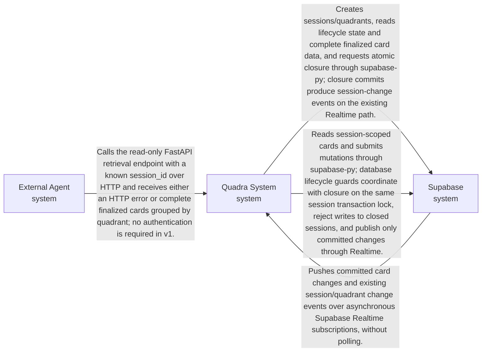
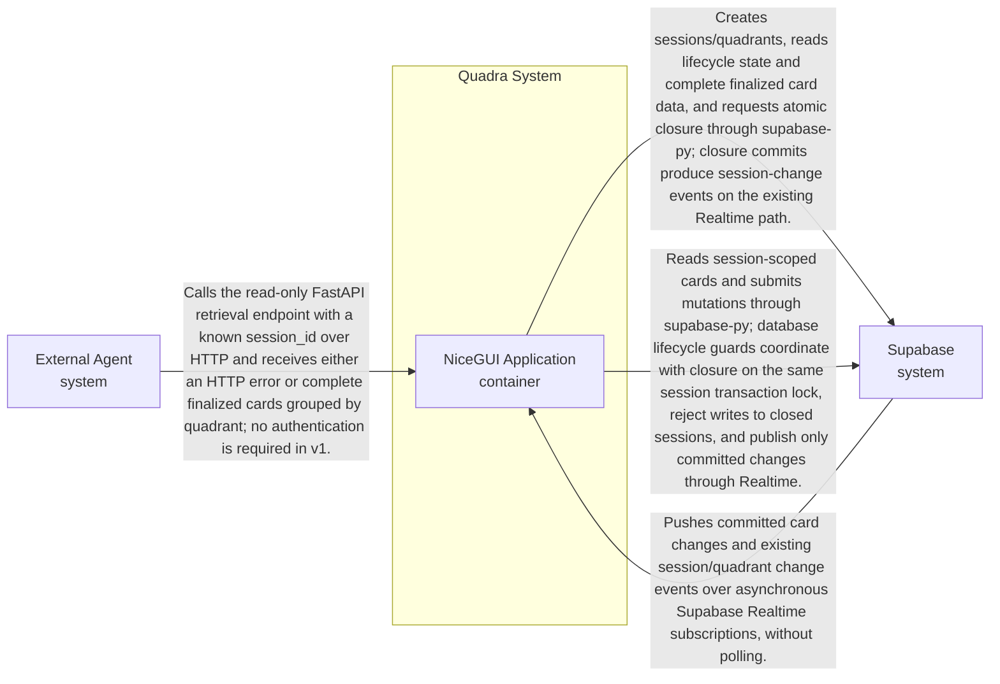
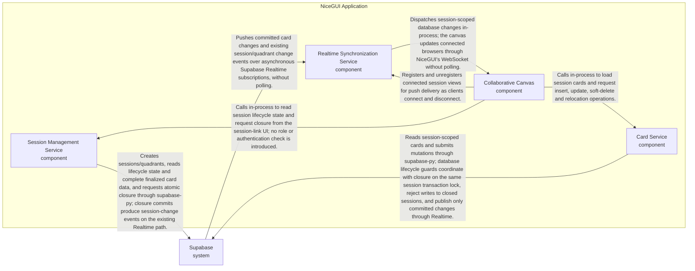

# ARCHITECTURE.md

## 1. System Mission

Quadra facilitates real-time team alignment by providing an ephemeral, highly responsive workspace where participants can co-create and manage quadrant-based decisions.

## 2. Business Goals

To provide a standardized, reliable, and real-time collaboration environment for team decision-making, specifically optimized for the rapid instantiation of workspace sessions.

## 3. Architectural Drivers

(none yet)

## 4. Architectural Style

The system follows a reactive, event-driven architecture. The client-side UI (NiceGUI) interacts with a lightweight FastAPI controller that delegates session persistence to Supabase. Supabase acts as both the primary database and the real-time event bus, ensuring that changes to the quadrant state are propagated to all connected clients within the 2000ms latency requirement.

## 5. Quality Attribute Scenarios

(none yet)

## 6. Tactics

(none yet)

## 7. Architectural Patterns

(none yet)

## 8. System Decomposition

The system consists of the NiceGUI-based web application, a session management service, and the external Supabase platform. Communication is centered around the Supabase Realtime engine, which synchronizes state between the backend and all active clients.

### Context

### Container

### Component: NiceGUI Application

| ID | Unit | Level | Parent | Owns | Does NOT own | Deployment | Tech Family |
|----|------|-------|--------|------|--------------|------------|-------------|
| quadra-system | Quadra System | system |  | Coordinates real-time decision-making via collaborative quadrants. |  |  |  |
| quadra-app | NiceGUI Application | container | quadra-system | Hosts the collaborative canvas and FastAPI session endpoints, including POST /sessions and read-only finalized-session retrieval; maps retrieval outcomes to HTTP responses. | Authoritative enforcement of session closure or user authentication. |  | FastAPI, NiceGUI, Python |
| session-service | Session Management Service | component | quadra-app | Creates sessions and their initial quadrants, reads session lifecycle state, requests the irreversible open-to-closed transition, and retrieves complete finalized card data grouped by the four quadrants for the FastAPI endpoint. | User roles, authentication, reopening or deleting closed sessions, Markdown export, or application-only enforcement of the card freeze. |  | Python module, supabase-py |
| supabase | Supabase | system |  | PostgreSQL storage and Realtime sync engine. Authoritatively enforces irreversible session closure and rejects every card insert, edit, move and soft-delete against a closed session using transactionally coordinated session-state checks and locking. | Browser pending-state reconciliation, API response formatting or participant authentication for Quadra v1. |  |  |
| card-service | Card Service | component | quadra-app | Loads session-scoped cards and persists insert, update, soft-delete and quadrant relocation operations, including ordering, anonymous display-name authorship and timestamps. Uses database-enforced lifecycle checks for every mutation and surfaces closed-session rejections to callers. | User authentication, durable browser-side state, delivery of Realtime events to connected clients, or bypassing the database closure guard. |  | Python module, supabase-py |
| realtime-service | Realtime Synchronization Service | component | quadra-app | Maintains asynchronous Supabase Realtime subscriptions within the NiceGUI event loop, routes database change notifications to connected views of the affected session, and manages subscription lifecycle and cleanup. | Card persistence, cursor tracking or a separate WebSocket gateway. |  | Python, supabase-py async Realtime API |
| collaborative-canvas | Collaborative Canvas | component | quadra-app | Renders session cards, captures anonymous display names and card operations, provides optimistic or quick-confirm feedback, and applies confirmed changes through NiceGUI. Offers session closure to any participant, renders closed sessions read-only, and reconciles pending operations and overlapping loads against authoritative persisted state without letting stale responses overwrite newer state or undo closure. | Authoritative card storage or lifecycle enforcement, user accounts, facilitator privileges, or direct browser subscriptions to Supabase. |  | Python, NiceGUI |
| external-agent | External Agent | system |  | Requests finalized quadrant data using a known session identifier. | Session lifecycle enforcement, card persistence or authentication. |  |  |

## 9. Communication Patterns

| From | To | Description |
|------|----|-------------|
| collaborative-canvas | card-service | Calls in-process to load session cards and request insert, update, soft-delete and relocation operations. |
| collaborative-canvas | realtime-service | Registers and unregisters connected session views for push delivery as clients connect and disconnect. |
| supabase | realtime-service | Pushes committed card changes and existing session/quadrant change events over asynchronous Supabase Realtime subscriptions, without polling. |
| realtime-service | collaborative-canvas | Dispatches session-scoped database changes in-process; the canvas updates connected browsers through NiceGUI's WebSocket without polling. |
| quadra-app | session-service | Calls in-process for POST /sessions and finalized-session retrieval; maps unknown sessions to 404, open sessions to 409 with "Session is still open", and closed sessions to successful grouped data responses. |
| session-service | supabase | Creates sessions/quadrants, reads lifecycle state and complete finalized card data, and requests atomic closure through supabase-py; closure commits produce session-change events on the existing Realtime path. |
| card-service | supabase | Reads session-scoped cards and submits mutations through supabase-py; database lifecycle guards coordinate with closure on the same session transaction lock, reject writes to closed sessions, and publish only committed changes through Realtime. |
| collaborative-canvas | session-service | Calls in-process to read session lifecycle state and request closure from the session-link UI; no role or authentication check is introduced. |
| external-agent | quadra-app | Calls the read-only FastAPI retrieval endpoint with a known session_id over HTTP and receives either an HTTP error or complete finalized cards grouped by quadrant; no authentication is required in v1. |

## 10. Data Architecture

(none yet)

## 11. Cross-cutting Concerns

(none yet)

## 12. Deployment Topology

(none yet)

## 13. Global Anti-Patterns

(none yet)

## 14. Open Architectural Risks

Realtime push is deferred. SPEC-0001 describes Supabase Realtime events pushed to every connected client through NiceGUI's WebSocket without polling, and the supabase to quadra-app relation in section 9 records it, but SPEC-0001's PBIs build only session creation and the canvas page. Until a later spec builds it, nothing proves that supabase-py's async Realtime client runs inside NiceGUI's event loop and meets STRAT-0001's < 2000ms target, which is the reason NiceGUI was chosen. The spec for Intent 2 (card operations) should build Realtime first, in its own PBI, before any card UI relies on it.

## 15. Architecture Decision Index

(none yet)

## 16. Related Artifacts

(none yet)

## Changelog

| Version | Date | Summary | Triggered by |
|---------|------|---------|--------------|
| 1.0 | 2026-10-16 | (no summary) | SPEC-0001 |
| 1.1 | 2026-10-16 | Record the deferral of Realtime push as an open risk | SPEC-0001 PBI review |
| 1.2 | 2026-10-17 | Add card persistence and an asynchronous Supabase-to-NiceGUI event bridge, with explicit cross-client push acceptance criteria under 2000ms. | SPEC-0002 |
| 1.3 | 2026-10-19 | Add database-enforced irreversible session closure, Realtime read-only canvas reconciliation, and finalized-session retrieval for external agents. | SPEC-0003 |
