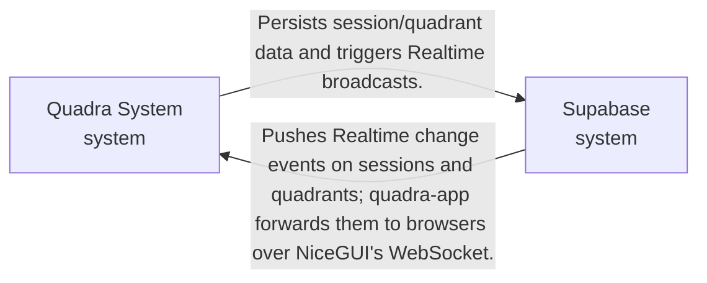
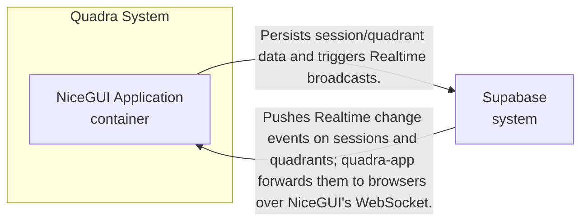
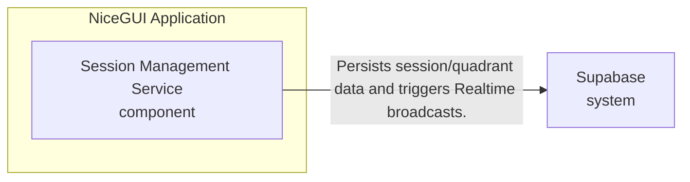

# ARCHITECTURE.md

## 1. System Mission

Quadra facilitates real-time team alignment by providing an ephemeral, highly responsive workspace where participants can co-create and manage quadrant-based decisions.

## 2. Business Goals

To provide a standardized, reliable, and real-time collaboration environment for team decision-making, specifically optimized for the rapid instantiation of workspace sessions.

## 3. Architectural Drivers

(none yet)

## 4. Architectural Style

The system follows a reactive, event-driven architecture. The client-side UI (NiceGUI) interacts with a lightweight FastAPI controller that delegates session persistence to Supabase. Supabase acts as both the primary database and the real-time event bus, ensuring that changes to the quadrant state are propagated to all connected clients within the 2000ms latency requirement.

## 5. Quality Attribute Scenarios

(none yet)

## 6. Tactics

(none yet)

## 7. Architectural Patterns

(none yet)

## 8. System Decomposition

The system consists of the NiceGUI-based web application, a session management service, and the external Supabase platform. Communication is centered around the Supabase Realtime engine, which synchronizes state between the backend and all active clients.

### Context

### Container

### Component: NiceGUI Application

| ID | Unit | Level | Parent | Owns | Does NOT own | Deployment | Tech Family |
|----|------|-------|--------|------|--------------|------------|-------------|
| quadra-system | Quadra System | system |  | Coordinates real-time decision-making via collaborative quadrants. |  |  |  |
| quadra-app | NiceGUI Application | container | quadra-system |  |  |  | FastAPI, NiceGUI, Python |
| session-service | Session Management Service | component | quadra-app |  |  |  | Python module, supabase-py |
| supabase | Supabase | system |  | PostgreSQL storage and Realtime sync engine. |  |  |  |

## 9. Communication Patterns

| From | To | Description |
|------|----|-------------|
| quadra-app | session-service | Calls create_session in-process to handle POST /sessions. |
| session-service | supabase | Persists session/quadrant data and triggers Realtime broadcasts. |
| supabase | quadra-app | Pushes Realtime change events on sessions and quadrants; quadra-app forwards them to browsers over NiceGUI's WebSocket. |

## 10. Data Architecture

(none yet)

## 11. Cross-cutting Concerns

(none yet)

## 12. Deployment Topology

(none yet)

## 13. Global Anti-Patterns

(none yet)

## 14. Open Architectural Risks

(none yet)

## 15. Architecture Decision Index

(none yet)

## 16. Related Artifacts

(none yet)

## Changelog

| Version | Date | Summary | Triggered by |
|---------|------|---------|--------------|
| 1.0 | 2026-10-16 | (no summary) | SPEC-0001 |
