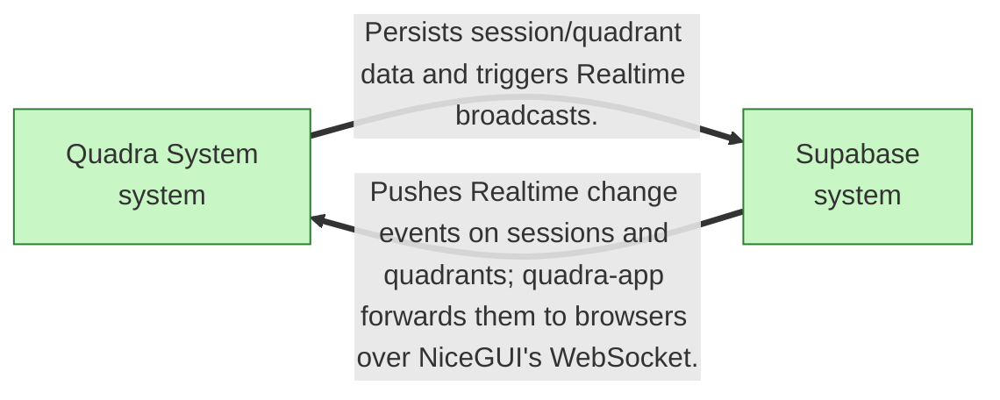
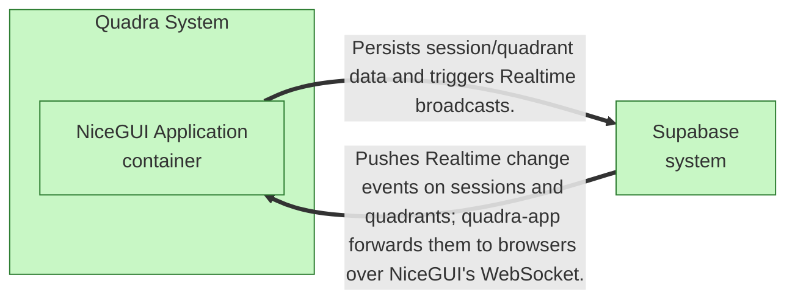
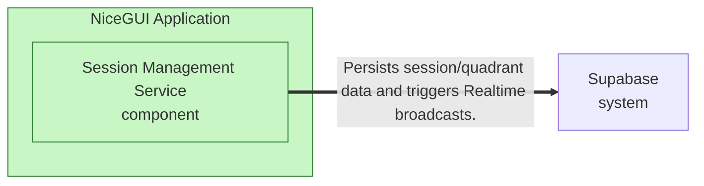

# Feature: Workspace and Realtime Canvas Initialization

## Blueprint

### Context

The project currently has no mechanism for initializing collaborative workspaces. This feature implements the entry point for team sessions, allowing users to define a feature or topic and automatically provision a session, its associated data in Supabase, and a canvas page that shows it. This is critical for establishing the team's shared workspace as envisioned in STRAT-0001.

Realtime push (Supabase Realtime events forwarded to every connected NiceGUI client without polling) is deferred to the spec for Intent 2 (card operations), where there are changes to broadcast. The Realtime relations and sections in the Architecture changes below describe the target architecture; docs/architecture.md section 14 records the deferral as an open risk. This spec does not build them.

### Feature Contract

- **C4 model elements involved:** quadra-app, session-service, supabase
- **API Contracts:** POST /sessions, request body {"feature_name": "string"}, response 201 {"session_id": "uuid", "status": "open", "link": "/sessions/{session_id}", "canvas": {"quadrants": ["IS", "IS NOT", "DOES", "DOES NOT"]}}
- **Data Models:** src/quadra/sessions.py: Session dataclass, src/quadra/api.py: SessionCreateRequest, SessionCreateResponse Pydantic models, supabase/migrations/0001_workspace.sql: workspaces, canvases, and quadrants tables
- **Dependencies:** depends on Supabase Python SDK (supabase-py), NiceGUI UI framework, FastAPI backend; needed by (none)
- **Constraints:** Session creation latency < 2000ms, feature_name must be non-empty, session_id must be a random UUIDv4
- **ADRs:** ADR-0001, ADR-0002
- **Critical components:** (none)

## Architecture changes

**Summary:** 

### Elements added

| ID | Unit | Level | Parent | Owns | Does NOT own | Deployment | Tech Family |
|----|------|-------|--------|------|--------------|------------|-------------|
| quadra-system | Quadra System | system |  | Coordinates real-time decision-making via collaborative quadrants. |  |  |  |
| quadra-app | NiceGUI Application | container | quadra-system |  |  |  | FastAPI, NiceGUI, Python |
| session-service | Session Management Service | component | quadra-app |  |  |  | Python module, supabase-py |
| supabase | Supabase | system |  | PostgreSQL storage and Realtime sync engine. |  |  |  |

### Relations added

| From | To | Description |
|------|----|-------------|
| quadra-app | session-service | Calls create_session in-process to handle POST /sessions. |
| session-service | supabase | Persists session/quadrant data and triggers Realtime broadcasts. |
| supabase | quadra-app | Pushes Realtime change events on sessions and quadrants; quadra-app forwards them to browsers over NiceGUI's WebSocket. |

### Sections replaced

#### Architectural Style

The system follows a reactive, event-driven architecture. The client-side UI (NiceGUI) interacts with a lightweight FastAPI controller that delegates session persistence to Supabase. Supabase acts as both the primary database and the real-time event bus, ensuring that changes to the quadrant state are propagated to all connected clients within the 2000ms latency requirement.

#### Business Goals

To provide a standardized, reliable, and real-time collaboration environment for team decision-making, specifically optimized for the rapid instantiation of workspace sessions.

#### System Decomposition

The system consists of the NiceGUI-based web application, a session management service, and the external Supabase platform. Communication is centered around the Supabase Realtime engine, which synchronizes state between the backend and all active clients.

#### System Mission

Quadra facilitates real-time team alignment by providing an ephemeral, highly responsive workspace where participants can co-create and manage quadrant-based decisions.

### Diagrams

#### Context



#### Container



#### Component: NiceGUI Application



## Contract

### Definition of Done

- [ ] POST /sessions creates a unique session record in Supabase with initial quadrant structure
- [ ] POST /sessions returns 201 status code and correct JSON response for valid input
- [ ] POST /sessions returns 422 status code for missing or empty feature_name
- [ ] NiceGUI canvas page /sessions/{session_id} renders correctly for existing sessions
- [ ] NiceGUI canvas page /sessions/{session_id} handles non-existent session IDs with a 'not found' message
- [ ] Session creation process completes within 2000ms threshold

### Regression Guardrails

- (none)

### Scenarios

```gherkin
Scenario: create session success
  Given  the system is initialized with schema 0001_workspace.sql
  When  a POST request is sent to /sessions with feature_name 'Test Feature'
  Then  the response is 201
  And  a session record exists in Supabase with status 'open'
  And  the response body contains a valid session_id and link
  And  tests/api/test_sessions.py::test_create_session_success passes

Scenario: create session validation fails on empty input
  Given  the API route exists
  When  a POST request is sent to /sessions with feature_name ''
  Then  the response is 422
  And  no session record is created in Supabase
  And  tests/api/test_sessions.py::test_create_session_validation passes

Scenario: access existing session link
  Given  a valid session with id '3f2b8c1e-6d4a-4b7e-9c2f-1a5d8e7b4c90' exists in Supabase
  When  a GET request is made to /sessions/3f2b8c1e-6d4a-4b7e-9c2f-1a5d8e7b4c90
  Then  the /sessions/3f2b8c1e-6d4a-4b7e-9c2f-1a5d8e7b4c90 page renders the canvas with quadrants IS, IS NOT, DOES, DOES NOT

Scenario: access non-existent session link
  Given  no session with id '00000000-0000-4000-8000-000000000000' exists in Supabase
  When  a GET request is made to /sessions/00000000-0000-4000-8000-000000000000
  Then  the /sessions/00000000-0000-4000-8000-000000000000 page displays 'Session not found'
```

## Changelog

| Version | Date | Summary | Triggered by |
|---------|------|---------|--------------|
| 1.1 | 2026-10-17 | Realtime push deferred to the Intent 2 spec: constraint removed, deferral stated in Context | landing acceptance of workflow f0888396e53a4bc2b5ee498a077aeafc |

## Sign-Off

**Authored by:** google:gemini-3.1-flash-lite  
**Reviewed by:** Marco — mcrasso@marsie.io

**Ready for PBI_PLANNING:** [x] Yes [ ] No
