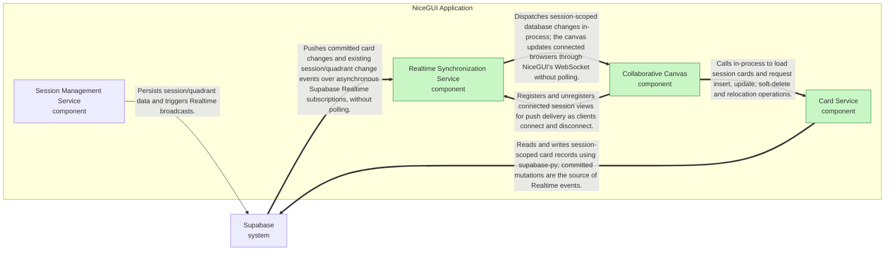

# Feature: Realtime collaborative card operations

## Blueprint

### Context

Quadra already creates sessions and renders their quadrant canvases, but participants cannot yet collaborate through persisted cards. Realtime delivery was described in SPEC-0001 without an executable implementation commitment, leaving the central multi-user latency requirement unproved.

This change establishes the asynchronous Supabase-to-NiceGUI push bridge before the card UI depends on it, then adds session-scoped card persistence and anonymous insert, edit, soft-delete and relocation interactions. Connected participants receive confirmed changes without polling, while initiating participants receive immediate pending feedback.

### Feature Contract

- **C4 model elements involved:** quadra-app, session-service, supabase, card-service, realtime-service, collaborative-canvas
- **API Contracts:** Existing POST /sessions and GET /sessions/{session_id} retain their public contracts; no new public HTTP card endpoint is required., Proposed src/quadra/cards.py in-process interface: list_cards(session_id), insert_card(session_id, quadrant_id, index, content, creator_display_name), update_card(session_id, card_id, content), soft_delete_card(session_id, card_id), relocate_card(session_id, card_id, quadrant_id, index). Mutations return the confirmed card or raise a typed validation/persistence error; client timestamps are not authoritative., Proposed src/quadra/realtime.py asynchronous interface: register_view(session_id, view_id, callback) and unregister_view(session_id, view_id). Registration exposes subscription readiness; callbacks receive committed session-scoped changes., Supabase Realtime Postgres Changes supplies committed card INSERT and UPDATE notifications; soft-delete is an UPDATE. Existing session/quadrant notifications remain supported., Proposed src/quadra/canvas.py handles anonymous display-name entry and card interactions, applies Realtime callbacks within the appropriate NiceGUI view context, and uses NiceGUI WebSocket delivery to update browsers.
- **Data Models:** Proposed public.cards schema in supabase/migrations/0002_cards.sql: id UUID primary key, session_id UUID referencing the existing session relation, quadrant_id referencing the existing quadrant relation, index non-negative integer, content text, creator_display_name non-empty trimmed text, created_at timestamptz, updated_at timestamptz, deleted_at nullable timestamptz. The referenced relation names and quadrant-id type must be taken from supabase/migrations/0001_workspace.sql rather than invented., Card identifiers are generated once per insertion and reused when reconciling optimistic and confirmed representations; this does not change UUIDv4 session identification., Card timestamps are server-generated UTC instants. Creator display name and created_at remain unchanged by edits, relocation and soft-delete; updated_at records each mutation., Active-card reads filter deleted_at IS NULL and order within each quadrant by index ascending, then card id ascending. Equal indexes are allowed; dense renumbering is not required., Anonymous display names are per connected view, not user identities or access-control credentials. Card content and names are rendered as escaped plain text., Pending browser representations are transient and keyed to the insertion identity or existing card id; Supabase remains the authoritative state.
- **Dependencies:** depends on Existing session persistence in src/quadra/sessions.py and initial workspace schema in supabase/migrations/0001_workspace.sql., Existing FastAPI/NiceGUI integration in src/quadra/api.py and src/quadra/app.py., Available supabase-py asynchronous Realtime subscription API, running in the NiceGUI event loop., Supabase Realtime publication configured for card changes and the existing session/quadrant notification sources., Integration infrastructure capable of running Supabase and two actual browser clients, observing database commit and DOM-render timing.; needed by Concurrent quadrant-based team decision-making described by docs/strategy/STRAT-0002.md., All card UI operations in this feature depend on the independently verified Realtime bridge.
- **Constraints:** Build and verify the Realtime bridge in its own increment before card UI increments depend on it., Use Supabase async Realtime subscriptions and NiceGUI's existing WebSocket; do not introduce polling, direct browser Supabase subscriptions or a separate WebSocket gateway., Use the stricter strategy target: database-commit-to-browser-render latency must be less than 2000ms, not merely less than or equal to it., Measure latency with subscription readiness established and a common test timing reference; do not substitute callback receipt for browser rendering., Load initial state after subscription readiness and reconcile notifications arriving during loading so a committed change is not lost between subscription and snapshot., Scope reads, writes and notifications by session; any participant with the existing session link may edit its cards without introducing accounts., Keep all persisted card fields authoritative on the server; do not add durable browser-side card storage., Release subscriptions when no views need them, and preserve shared subscriptions while another registered view remains., Plain-text cards only; cursor tracking, authentication, export and rich-text formatting remain out of scope., The strategy supplies no quantitative concurrency or network-delay envelope; the less-than-2000ms acceptance check uses the declared integration fixture and is not a claim of an unlimited-load service-level guarantee.
- **ADRs:** ADR-0001, ADR-0002, ADR-0003, ADR-0004
- **Critical components:** (none)

## Architecture changes

**Summary:** Add card persistence and an asynchronous Supabase-to-NiceGUI event bridge, with explicit cross-client push acceptance criteria under 2000ms.

### Elements added

| ID | Unit | Level | Parent | Owns | Does NOT own | Deployment | Tech Family |
|----|------|-------|--------|------|--------------|------------|-------------|
| card-service | Card Service | component | quadra-app | Loads session-scoped cards and persists insert, update, soft-delete and quadrant relocation operations, including ordering, anonymous display-name authorship and timestamps. | User authentication, durable browser-side state or delivery of Realtime events to connected clients. |  | Python module, supabase-py |
| realtime-service | Realtime Synchronization Service | component | quadra-app | Maintains asynchronous Supabase Realtime subscriptions within the NiceGUI event loop, routes database change notifications to connected views of the affected session, and manages subscription lifecycle and cleanup. | Card persistence, cursor tracking or a separate WebSocket gateway. |  | Python, supabase-py async Realtime API |
| collaborative-canvas | Collaborative Canvas | component | quadra-app | Renders session cards, captures anonymous display names and card operations, provides optimistic or quick-confirm feedback for the initiating participant, and applies confirmed changes to connected browser views through NiceGUI. | Authoritative card storage, user accounts or direct browser subscriptions to Supabase. |  | Python, NiceGUI |

### Relations added

| From | To | Description |
|------|----|-------------|
| collaborative-canvas | card-service | Calls in-process to load session cards and request insert, update, soft-delete and relocation operations. |
| card-service | supabase | Reads and writes session-scoped card records using supabase-py; committed mutations are the source of Realtime events. |
| collaborative-canvas | realtime-service | Registers and unregisters connected session views for push delivery as clients connect and disconnect. |
| supabase | realtime-service | Pushes committed card changes and existing session/quadrant change events over asynchronous Supabase Realtime subscriptions, without polling. |
| realtime-service | collaborative-canvas | Dispatches session-scoped database changes in-process; the canvas updates connected browsers through NiceGUI's WebSocket without polling. |

### Relations removed

| From | To | Description |
|------|----|-------------|
| supabase | quadra-app | Pushes Realtime change events on sessions and quadrants; quadra-app forwards them to browsers over NiceGUI's WebSocket. |

### Diagrams

#### Context

```mermaid
flowchart LR
classDef added fill:#c8f7c5,stroke:#2e7d32
classDef changed fill:#fff3b0,stroke:#b59f00
classDef removed fill:#f8c8c8,stroke:#c62828
quadra_system["Quadra System<br/>system"]
supabase["Supabase<br/>system"]
quadra_system -->|Persists session/quadrant data and triggers Realtime broadcasts.| supabase
quadra_system ==>|Reads and writes session-scoped card records using supabase-py; committed mutations are the source of Realtime events.| supabase
supabase ==>|Pushes committed card changes and existing session/quadrant change events over asynchronous Supabase Realtime subscriptions, without polling.| quadra_system
supabase -.->|Pushes Realtime change events on sessions and quadrants; quadra-app forwards them to browsers over NiceGUI's WebSocket. (removed)| quadra_system
```

#### Container

```mermaid
flowchart LR
classDef added fill:#c8f7c5,stroke:#2e7d32
classDef changed fill:#fff3b0,stroke:#b59f00
classDef removed fill:#f8c8c8,stroke:#c62828
subgraph quadra_system["Quadra System"]
  quadra_app["NiceGUI Application<br/>container"]
end
supabase["Supabase<br/>system"]
quadra_app -->|Persists session/quadrant data and triggers Realtime broadcasts.| supabase
quadra_app ==>|Reads and writes session-scoped card records using supabase-py; committed mutations are the source of Realtime events.| supabase
supabase ==>|Pushes committed card changes and existing session/quadrant change events over asynchronous Supabase Realtime subscriptions, without polling.| quadra_app
supabase -.->|Pushes Realtime change events on sessions and quadrants; quadra-app forwards them to browsers over NiceGUI's WebSocket. (removed)| quadra_app
```

#### Component: NiceGUI Application



## Contract

### Definition of Done

- [ ] A Supabase migration creates session-scoped card storage with quadrant, ordering index, plain-text content, anonymous creator display name, creation/update timestamps and a nullable soft-deletion timestamp.
- [ ] The Realtime bridge delivers an event caused by one connected client to another connected view of the same session in less than 2000ms from database commit to browser rendering, without polling; this is verifiable independently of the card-operation UI.
- [ ] Realtime delivery does not send a session's card changes to views registered for another session.
- [ ] Disconnecting the last view of a session releases its Realtime subscription.
- [ ] Opening an existing session loads its persisted, non-deleted cards in deterministic quadrant order.
- [ ] An anonymous participant can insert a plain-text card into a session quadrant, preserving their creator display name and server-generated timestamps.
- [ ] A participant can edit a card's plain-text content without changing its original creator display name or creation timestamp.
- [ ] A participant can soft-delete a card so that it disappears from connected canvases while its database record remains.
- [ ] A participant can relocate a card to another quadrant and persist its target ordering index.
- [ ] The initiating participant sees a pending card insertion or movement before its database request completes.
- [ ] A rejected optimistic insertion or movement is removed or rolled back, respectively, with a visible failure indication.
- [ ] Confirmed insert, edit, soft-delete and relocation operations are reflected in a second connected browser in less than 2000ms from database commit.
- [ ] Card mutations reject references to a quadrant or card outside the specified session without modifying persisted state.

### Regression Guardrails

- POST /sessions continues to return 201 with the existing response schema and a unique UUIDv4 session identifier for valid input.
- Session creation continues to persist the initial quadrant structure.
- POST /sessions continues to return 422 for missing or empty feature_name.
- The existing /sessions/{session_id} page remains accessible for a valid session, including sessions with no cards.
- The existing /sessions/{session_id} page continues to show a not-found message for an unknown session identifier.
- Session creation continues to complete in less than 2000ms.
- Adding card notifications does not suppress existing session/quadrant notifications on the shared Realtime delivery path.

### Scenarios

```gherkin
Scenario: Persist the card schema
  Given  A test Supabase database has the existing workspace migration applied
  And  A session S and its quadrant Q1 exist
  When  The new card migration is applied and a valid card fixture is inserted through the migrated schema
  Then  The row can be read with its id, session_id, quadrant_id, index, content, creator_display_name, created_at, updated_at and deleted_at fields
  And  created_at and updated_at are populated by the server and deleted_at is null
  And  Inserts with a missing session reference or a negative index fail schema validation

Scenario: Deliver Realtime push before building the card UI
  Given  Two real browser clients A and B are connected to session S through NiceGUI
  And  B uses a test-only session-view callback that renders received card identifiers into a DOM event log
  And  The Realtime bridge is subscribed and ready
  And  Periodic database reads and browser polling are disabled and instrumented to fail the test
  And  The production card-operation UI is not required by this fixture
  When  A inserts card C in S through an integration harness calling card-service
  Then  B's DOM event log contains C less than 2000ms after the database commit
  And  The recorded delivery path includes a Supabase Realtime notification and a NiceGUI WebSocket update
  And  No periodic database read or browser polling request occurs

Scenario: Isolate Realtime delivery by session
  Given  Browser A is registered for session S1
  And  Browser B is registered only for session S2
  And  A test records all events dispatched to B
  When  A card is committed in S1
  Then  The dispatch record for B contains no event for S1
  And  B's rendered cards remain unchanged

Scenario: Release the final session subscription
  Given  Session S has one registered view and one active Supabase Realtime subscription
  And  The Realtime adapter records unsubscribe acknowledgements
  When  The final view disconnects
  Then  The adapter acknowledges removal of S's subscription
  And  The session-view registry contains no view for S

Scenario: Load persisted active cards deterministically
  Given  Session S contains active cards A and B in Q1 with indexes 2 and 1
  And  Session S contains soft-deleted card C
  And  Another session contains active card D
  When  A browser opens /sessions/{S}
  Then  Q1 renders B before A
  And  Neither C nor D is rendered
  And  Reloading the page produces the same ordering

Scenario: Insert a card with anonymous authorship
  Given  A browser displays session S with quadrant Q1
  And  The participant has entered display name Alice
  And  The card composer contains plain text Compare options
  When  The participant submits the card composer for Q1
  Then  One active card with content Compare options is persisted in S and Q1
  And  Its creator_display_name is Alice
  And  Its created_at and updated_at are server-generated timestamps
  And  The confirmed card displays Alice and its creation timestamp

Scenario: Edit content without replacing authorship
  Given  Card C in session S has content Draft, creator_display_name Alice and creation timestamp T
  And  A participant using display name Bob has opened C's editor
  When  Bob submits Revised as C's content
  Then  C's persisted and rendered content is Revised
  And  C's creator_display_name remains Alice
  And  C's created_at remains T
  And  C's updated_at advances to the server update time

Scenario: Soft-delete without losing the database record
  Given  Active card C is visible in two connected browsers for session S
  When  One participant deletes C
  Then  C is absent from both canvases after confirmation
  And  C's database row still exists with a non-null deleted_at
  And  A fresh active-card query for S excludes C

Scenario: Relocate a card and persist ordering
  Given  Active card C is in Q1 at index 0 in session S
  And  Q2 belongs to S
  When  A participant moves C to Q2 with target index 3
  Then  C's persisted quadrant is Q2 and index is 3
  And  A fresh page load places C in Q2 according to index then card-id ordering
  And  C's original creator and creation timestamp are unchanged

Scenario: Show pending insertion before confirmation
  Given  A participant has composed a card in Q1
  And  The insert request is held unresolved by a controllable test barrier
  When  The participant submits the card
  Then  A visibly pending card appears in Q1 while the request remains unresolved

Scenario: Show pending movement before confirmation
  Given  Card C is visible in Q1
  And  The relocation request is held unresolved by a controllable test barrier
  When  The participant moves C to Q2
  Then  C appears in Q2 with pending status while the request remains unresolved

Scenario: Recover from rejected optimistic operations
  Given  A parameterized browser fixture has either a pending insertion or a pending movement from Q1 to Q2
  And  The persisted state has not changed
  When  The pending operation receives a persistence failure
  Then  For insertion the pending card is removed
  And  For movement the card returns to its original quadrant and index
  And  The initiating browser displays a failure message

Scenario: Propagate every supported card operation to another browser
  Given  Browsers A and B display the same session with Realtime readiness confirmed
  And  A parameterized fixture selects insert, content edit, soft-delete or relocation
  And  The fixture supplies the existing card required for the selected operation
  And  Polling is disabled and database commit and browser-render timestamps are captured
  When  A performs the selected card operation through the production canvas
  Then  B renders the inserted card, edited content, card removal or relocated card, respectively
  And  The elapsed time from database commit to B's matching render is less than 2000ms
  And  The initiating browser shows the confirmed persisted state without a duplicate card

Scenario: Reject cross-session card mutations
  Given  Session S1 contains card C1 and quadrant Q1
  And  Session S2 contains card C2 and quadrant Q2
  And  The test snapshots the persisted cards
  When  A parameterized card-service call for S1 attempts insertion into Q2, editing C2, deleting C2 or relocating C1 to Q2
  Then  The call returns a validation failure
  And  The persisted card snapshot is unchanged

Scenario: Preserve session creation response
  Given  The existing session API test fixture is configured with Supabase persistence
  When  The existing valid-session creation test submits two requests with non-empty feature_name values
  Then  Both responses have status 201 and match the existing response-schema assertions
  And  Their session identifiers are distinct valid UUIDv4 values

Scenario: Preserve initial quadrant creation
  Given  The existing session persistence integration fixture is configured
  When  POST /sessions creates a valid session
  Then  The persisted initial quadrant structure matches the existing SPEC-0001 integration assertions

Scenario: Preserve feature-name validation
  Given  The existing session API validation fixture supplies either a missing feature_name or an empty feature_name
  When  The fixture submits POST /sessions
  Then  The response status is 422

Scenario: Preserve access to an empty session
  Given  A valid persisted session has its initial quadrants and no cards
  When  A browser opens its /sessions/{session_id} URL
  Then  The existing session page and initial quadrants render
  And  No card-loading error replaces the canvas

Scenario: Preserve missing-session handling
  Given  A UUIDv4 session identifier does not exist in Supabase
  When  A browser opens /sessions/{session_id} for that identifier
  Then  The existing not-found message is displayed

Scenario: Preserve session-creation latency
  Given  The existing session-creation latency integration fixture is configured
  And  Card storage and the Realtime bridge are enabled
  When  The fixture submits a valid POST /sessions request
  Then  The response completes in less than 2000ms

Scenario: Preserve existing session and quadrant event delivery
  Given  Two registered views of session S record session, quadrant and card notifications
  And  Card subscriptions are enabled
  And  A parameterized fixture selects an existing session event or an existing quadrant event
  When  The fixture commits the selected change to S
  Then  Both views receive the selected notification with its original session identity and payload
  And  The notification is not filtered out as a non-card event

Scenario: Enforce the shared push-delivery architecture
  Given  The Realtime bridge and its instrumented integration fixtures are implemented
  When  The test tests/integration/test_realtime.py::test_push_delivery_without_polling runs
  Then  It passes

Scenario: Enforce authoritative session-scoped card persistence
  Given  The migrated card schema and card-service integration fixtures are implemented
  When  The test tests/integration/test_cards_supabase.py::test_session_scope_and_soft_delete runs
  Then  It passes
```

## Changelog

| Version | Date | Summary | Triggered by |
|---------|------|---------|--------------|

## Sign-Off

**Authored by:** openrouter:openai/gpt-6.1-sol  
**Reviewed by:** _(pending)_ — _(pending)_

**Ready for PBI_PLANNING:** [ ] Yes [ ] No
