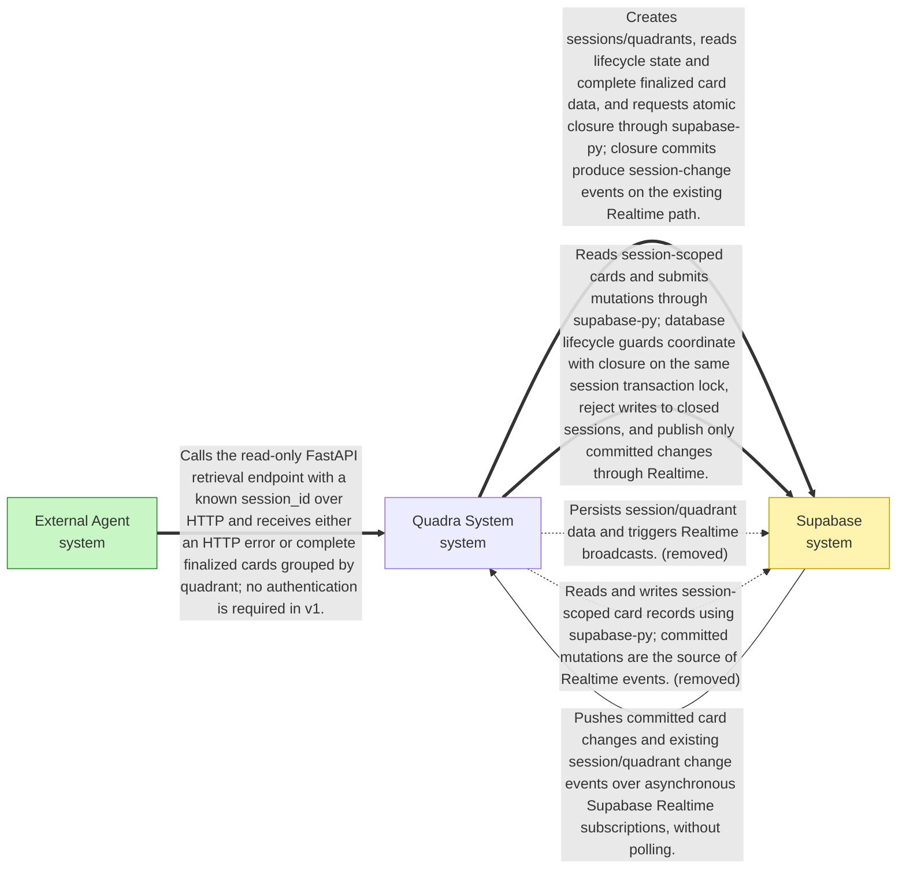
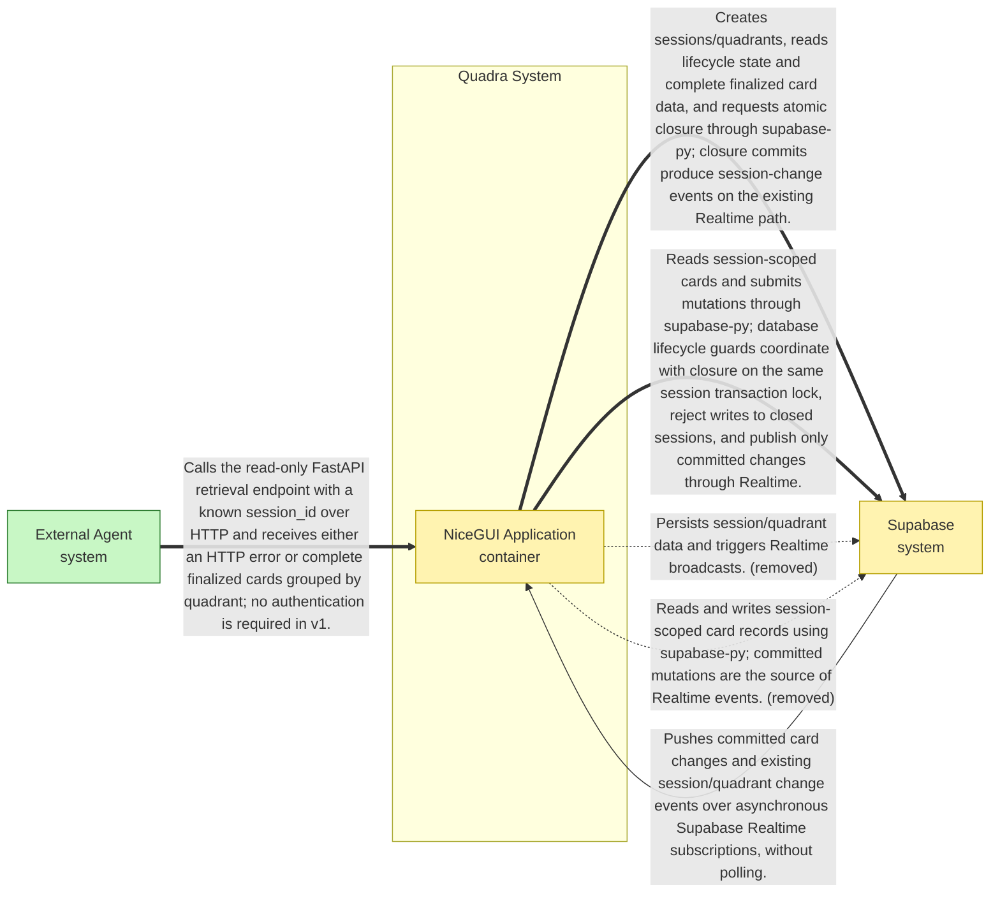
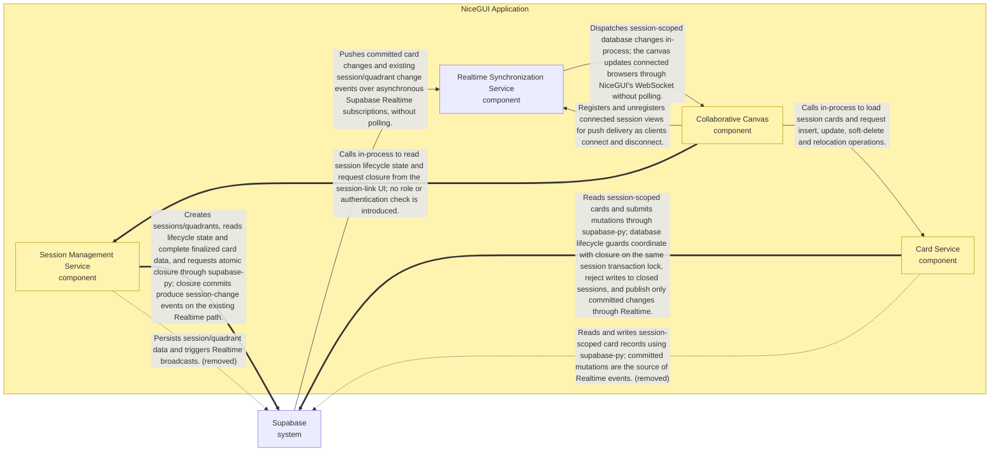

# Feature: Irreversible session closure and finalized quadrant retrieval

## Blueprint

### Context

Quadra currently supports ongoing collaborative card changes but has no enforced finalization boundary. Participants need to close a workspace so its decisions stop changing and external agents can retrieve a complete finalized result. STRAT-0003 requires this boundary to live in Supabase rather than merely disabling browser controls, including when a request was already pending at closure.

This change adds irreversible closure, read-only connected canvases and a finalized-data FastAPI endpoint. Closure and retrieval deliberately require no roles or authentication in v1: link possession allows closure, and knowledge of a session UUID allows reading its closed data. This is a lifecycle restriction, not a confidentiality or authentication guarantee. Pending operations and overlapping loads must reconcile to authoritative closed state rather than undo closure or lose cards.

### Feature Contract

- **C4 model elements involved:** quadra-app, session-service, supabase, card-service, realtime-service, collaborative-canvas, external-agent
- **API Contracts:** Add GET /sessions/{session_id}/data in src/quadra/api.py next to POST /sessions. session_id is a UUID; normal FastAPI UUID validation applies. No credentials are required., GET /sessions/{session_id}/data: unknown valid UUID returns 404; an existing open session returns 409 with {"detail":"Session is still open"}; a closed session returns 200 application/json., Successful retrieval response: {"session_id":"<uuid>","status":"closed","quadrants":[{"id":"<persisted quadrant id>","name":"<persisted quadrant name>","position":0,"cards":[{"id":"<card id>","content":"<plain text>","author_display_name":"<stored display name>","index":0,"created_at":"<timestamp>","updated_at":"<timestamp>"}]}]}. Always return all four persisted quadrant groups, even when empty, each with its persisted id, name and position so a caller can tell the quadrants apart. Map existing stored field names to these response keys without renaming existing storage unnecessarily., Use the existing deterministic quadrant/card ordering, with stable id tie-breaking when ordering indices are equal. Return persisted timestamps as timezone-aware ISO 8601 values. Exhaust pagination rather than accepting a single Supabase response page., Add session-service operations close_session(session_id) and get_finalized_session_data(session_id) in src/quadra/sessions.py. Closure is called in-process by src/quadra/canvas.py; no new HTTP closure endpoint is required. Repeated closure returns closed successfully; unknown sessions produce a not-found outcome., The card service surfaces the database's closed-session rejection as a distinguishable failure to the canvas; existing successful mutation contracts remain unchanged., Keep POST /sessions and its response schema unchanged.
- **Data Models:** Extend the existing session record with status constrained to open or closed, default open, backfilling existing sessions as open. Use supabase/migrations/0005_session_closure.sql for the new migration., Use the existing session, quadrant and card tables and their existing identifiers. Existing card content, display name, index, created_at, updated_at and deleted_at fields remain authoritative., Add database close-session RPC close_session(p_session_id uuid), updating the session row atomically under its row lock and treating an already closed row as success., Install session lifecycle triggers preventing closed-to-open transitions and deletion of closed sessions. A card trigger on INSERT, UPDATE and DELETE locks the owning session row and rejects changes if it is closed; UPDATE checks both old and new owning sessions if reassignment is attempted., The card trigger raises a stable closed-session database error, using SQLSTATE P0001 and message 'Session is closed', which the Python card service maps to a distinguishable closed-session rejection., Canvas view state tracks a monotonic closed latch and an asynchronous-state generation. Pending operations and load responses carry their originating generation so stale responses cannot mutate reconciled state.
- **Dependencies:** depends on STRAT-0003 in docs/strategy/STRAT-0003.md., Existing session persistence and FastAPI routing in src/quadra/sessions.py and src/quadra/api.py., Existing card persistence, complete pagination and deterministic ordering in src/quadra/cards.py., Existing shared asynchronous Realtime bridge in src/quadra/realtime.py and NiceGUI canvas in src/quadra/canvas.py., Supabase PostgreSQL migrations, row locks, triggers, RPC execution and existing session-change publication., Existing Supabase-backed integration harness under tests/integration and existing API/session/card regression suites.; needed by external-agent finalized quadrant consumption., Any later finalized-session export, including the separately scoped Markdown export; export implementation is not included here.
- **Constraints:** Implement within the supplied architecture; do not add a separate WebSocket gateway, browser Supabase subscriptions or polling., There are no roles or authentication in v1. Anyone with a session link may close it; anyone knowing its UUID may retrieve closed data., Closure is irreversible. Reopening, deletion of closed sessions, a closed-session dashboard and Markdown export are out of scope., Every application-accessible card write must pass database lifecycle enforcement, including direct writes using the configured database role. Superuser administration, disabling triggers and destructive schema administration are outside the application contract., Use the session row as the shared transaction lock for closure and card writes. A request that began earlier has no right to commit after closure; only mutations serialized and committed before closure survive in the final snapshot., Do not rely on application prechecks, browser disabled controls or client timestamps to enforce the freeze., Subscribe/register before initial loading and reconcile closure monotonically. On closure, invalidate older response generations, clear optimistic overlays and load every authoritative card page before considering reconciliation complete., If reconciliation fails, keep the view closed and non-editable, show a load failure and allow retry; never present an incomplete load as the finalized result., Only show a 'not saved' indication after authoritative reconciliation, when the authoritative closed-session cards do not reflect the pending change, and remove it if that change's delayed success response arrives (see the known limit). A change committed before closure must remain visible even if its response arrives late., A failed closure request must consult authoritative lifecycle state before restoring editability; failure to confirm open must not override a received closed state., Preserve plain-text rendering and existing session-scoped card ownership validation., Use existing persisted quadrant identities and ordering rather than inventing quadrant labels or replacing the four-quadrant structure.
- **Known limit (1.2):** when closure arrives while a card operation's response is still delayed, the canvas decides whether that operation was saved only by comparing it with the authoritative closed-session cards. An edit or move to the value already persisted, or a committed change that another participant overwrote or soft-deleted before closure, cannot be told apart from an unsaved one and may show the 'not saved' notice. If that operation's delayed success response arrives later, the canvas removes the notice. A request id stored with each committed mutation would remove this limit.
- **ADRs:** ADR-0001, ADR-0002, ADR-0003, ADR-0004, ADR-0005, ADR-0006, ADR-0007
- **Critical components:** (none)

## Architecture changes

**Summary:** Add database-enforced irreversible session closure, Realtime read-only canvas reconciliation, and finalized-session retrieval for external agents.

### Elements added

| ID | Unit | Level | Parent | Owns | Does NOT own | Deployment | Tech Family |
|----|------|-------|--------|------|--------------|------------|-------------|
| external-agent | External Agent | system |  | Requests finalized quadrant data using a known session identifier. | Session lifecycle enforcement, card persistence or authentication. |  |  |

### Elements changed

| ID | Unit | Level | Parent | Owns | Does NOT own | Deployment | Tech Family |
|----|------|-------|--------|------|--------------|------------|-------------|
| quadra-app | NiceGUI Application | container | quadra-system | Hosts the collaborative canvas and FastAPI session endpoints, including POST /sessions and read-only finalized-session retrieval; maps retrieval outcomes to HTTP responses. | Authoritative enforcement of session closure or user authentication. |  | FastAPI, NiceGUI, Python |
| session-service | Session Management Service | component | quadra-app | Creates sessions and their initial quadrants, reads session lifecycle state, requests the irreversible open-to-closed transition, and retrieves complete finalized card data grouped by the four quadrants for the FastAPI endpoint. | User roles, authentication, reopening or deleting closed sessions, Markdown export, or application-only enforcement of the card freeze. |  | Python module, supabase-py |
| card-service | Card Service | component | quadra-app | Loads session-scoped cards and persists insert, update, soft-delete and quadrant relocation operations, including ordering, anonymous display-name authorship and timestamps. Uses database-enforced lifecycle checks for every mutation and surfaces closed-session rejections to callers. | User authentication, durable browser-side state, delivery of Realtime events to connected clients, or bypassing the database closure guard. |  | Python module, supabase-py |
| collaborative-canvas | Collaborative Canvas | component | quadra-app | Renders session cards, captures anonymous display names and card operations, provides optimistic or quick-confirm feedback, and applies confirmed changes through NiceGUI. Offers session closure to any participant, renders closed sessions read-only, and reconciles pending operations and overlapping loads against authoritative persisted state without letting stale responses overwrite newer state or undo closure. | Authoritative card storage or lifecycle enforcement, user accounts, facilitator privileges, or direct browser subscriptions to Supabase. |  | Python, NiceGUI |
| supabase | Supabase | system |  | PostgreSQL storage and Realtime sync engine. Authoritatively enforces irreversible session closure and rejects every card insert, edit, move and soft-delete against a closed session using transactionally coordinated session-state checks and locking. | Browser pending-state reconciliation, API response formatting or participant authentication for Quadra v1. |  |  |

### Relations added

| From | To | Description |
|------|----|-------------|
| quadra-app | session-service | Calls in-process for POST /sessions and finalized-session retrieval; maps unknown sessions to 404, open sessions to 409 with "Session is still open", and closed sessions to successful grouped data responses. |
| session-service | supabase | Creates sessions/quadrants, reads lifecycle state and complete finalized card data, and requests atomic closure through supabase-py; closure commits produce session-change events on the existing Realtime path. |
| card-service | supabase | Reads session-scoped cards and submits mutations through supabase-py; database lifecycle guards coordinate with closure on the same session transaction lock, reject writes to closed sessions, and publish only committed changes through Realtime. |
| collaborative-canvas | session-service | Calls in-process to read session lifecycle state and request closure from the session-link UI; no role or authentication check is introduced. |
| external-agent | quadra-app | Calls the read-only FastAPI retrieval endpoint with a known session_id over HTTP and receives either an HTTP error or complete finalized cards grouped by quadrant; no authentication is required in v1. |

### Relations removed

| From | To | Description |
|------|----|-------------|
| quadra-app | session-service | Calls create_session in-process to handle POST /sessions. |
| session-service | supabase | Persists session/quadrant data and triggers Realtime broadcasts. |
| card-service | supabase | Reads and writes session-scoped card records using supabase-py; committed mutations are the source of Realtime events. |

### Diagrams

#### Context



#### Container



#### Component: NiceGUI Application



## Contract

### Definition of Done

- [ ] A Supabase migration gives existing and newly created sessions an authoritative lifecycle status of open unless already closed.
- [ ] Closing an open session from its canvas persists status closed; repeating closure succeeds without reopening the session.
- [ ] Database operations cannot reopen or delete a closed session.
- [ ] Database enforcement rejects inserts, content edits, quadrant/index moves and soft-deletes against a closed session without changing card state, including writes submitted without the card service.
- [ ] Closure and card mutations serialize on the same session-row lock: a mutation committed before closure is retained, but a mutation whose authoritative check follows closure is rejected even if its request started earlier.
- [ ] A successfully committed closure makes every connected view of that session read-only through the existing Realtime path in less than 2000ms from commit.
- [ ] Opening a closed session renders its complete persisted non-deleted card set read-only.
- [ ] When closure arrives while a card change is pending, the canvas invalidates that operation's optimistic overlay and reconciles to complete authoritative closed-session state; delayed successes, failures and loads cannot restore the overlay, overwrite newer state or re-enable editing.
- [ ] A failed closure request leaves an authoritatively open session editable and displays a failure indication.
- [ ] GET /sessions/{session_id}/data returns 409 with JSON {"detail":"Session is still open"} for an existing open session.
- [ ] GET /sessions/{session_id}/data returns 404 for an unknown valid session UUID.
- [ ] GET /sessions/{session_id}/data returns 200 for a closed session with every non-deleted card grouped into all four quadrants, including empty quadrants, each quadrant with its id, name and position, and each card's content, author display name, index, creation timestamp and update timestamp.
- [ ] Any participant with a session link can close the session without credentials, and any caller knowing a closed session_id can retrieve its finalized data without credentials.

### Regression Guardrails

- POST /sessions retains its existing 201 response schema, unique UUIDv4 identifiers, initial quadrant persistence, validation of missing or empty feature_name with 422, and completion time below 2000ms.
- For open sessions, insertion, editing, relocation and soft-deletion retain their existing persistence semantics, including creator/creation-time preservation, retained soft-deleted rows and session-boundary validation.
- For open sessions, optimistic insert/move feedback and rejected-operation rollback retain their existing visible behavior without allowing older completions to overwrite newer changes.
- Existing-session loading remains complete beyond the Supabase page limit and deterministically ordered; valid empty sessions remain accessible and unknown session links still show the not-found message.
- The shared Realtime bridge continues to deliver committed card changes without polling in less than 2000ms, preserves session/quadrant notifications, isolates sessions and releases a subscription when its last view disconnects.
- Closing one session neither freezes nor changes the persisted cards or canvas editability of another open session.

### Scenarios

```gherkin
Scenario: Initialize session lifecycle without changing existing cards
  Given  The database before migration contains a session S with four quadrants and two persisted cards
  And  The lifecycle migration has not been applied
  When  supabase/migrations/0005_session_closure.sql is applied
  Then  S has status open
  And  S retains the same four quadrants and two card records
  And  A session inserted using the existing creation path defaults to status open

Scenario: Close a session from its link without credentials
  Given  Session S is open
  And  A participant has opened /sessions/S
  And  The participant has no authentication credentials or role
  When  The participant activates the Close session control
  Then  The stored status of S is closed
  And  The participant's canvas shows that S is closed

Scenario: Repeat closure idempotently
  Given  Session S is already closed with a recorded card snapshot
  When  The session service is asked to close S again
  Then  The service returns the closed state without an error
  And  The stored status and card snapshot remain unchanged

Scenario: Reject reopening and deletion of closed sessions
  Given  Session S is closed and has persisted cards
  And  A database integration test is parameterized over UPDATE status to open and DELETE session
  When  The selected database operation is attempted using the application's database access role
  Then  The database rejects the operation
  And  S still exists with status closed
  And  Its persisted card snapshot is unchanged

Scenario: Reject every card mutation at the database boundary
  Given  Session S is closed and contains card C
  And  The test is parameterized over insert, content edit, quadrant/index move and setting deleted_at
  And  The test is parameterized over the card-service path and direct database writes using the application's database access role
  When  The selected mutation is submitted through the selected path
  Then  The mutation is rejected with the closed-session error
  And  No card record in S differs from the pre-request snapshot

Scenario: Reject an earlier-started mutation when closure wins the lock
  Given  Session S is open with card C
  And  A mutation request for S has started but is paused before acquiring the session-row lock
  And  The test is parameterized over insert, edit, move and soft-delete
  And  Closure has acquired the same session-row lock
  When  The concurrency harness commits closure and releases the paused mutation
  Then  S is closed
  And  The mutation returns the closed-session rejection
  And  The card snapshot equals the snapshot at closure commit

Scenario: Retain a mutation committed before closure
  Given  Session S is open
  And  A card mutation holds S's session-row lock
  And  A concurrent closure request is waiting for that lock
  When  The mutation transaction commits
  Then  The waiting closure can complete with S closed
  And  The mutation's committed result is present in finalized retrieval
  And  No card mutation commits after the closure transaction commits

Scenario: Push closure to another connected participant
  Given  Two views A and B are registered for open session S through the existing Realtime bridge
  And  B currently exposes insert, edit, move and soft-delete controls
  When  A closes S successfully
  Then  B shows S as closed in less than 2000ms from the closure database commit
  And  B cannot initiate insert, edit, move or soft-delete actions
  And  The update uses the existing Supabase-to-NiceGUI push path without polling

Scenario: Load a closed session completely and read-only
  Given  Closed session S contains more active cards than one configured Supabase page can return
  And  Its active cards span all four quadrants and it also contains soft-deleted cards
  When  A participant opens /sessions/S
  Then  Every active card is rendered exactly once in existing deterministic order
  And  No soft-deleted card is rendered
  And  The session is marked closed and all card mutation controls are disabled or absent

Scenario: Discard pending changes rejected by closure
  Given  View B has a pending card operation in open session S
  And  The test is parameterized over insert, edit, move and soft-delete
  And  The operation has not committed before S closes
  And  B receives S's committed closure through Realtime
  And  The operation response is still delayed
  When  B applies the closure notification
  Then  B removes pending optimistic overlays and renders the complete authoritative closed-session cards
  And  An uncommitted insertion is absent and an uncommitted edit, move or deletion is not displayed as persisted
  And  B displays that the pending change was not saved because the session closed, since the authoritative closed-session cards do not reflect it
  And  B remains read-only

Scenario: Keep a pre-closure commit despite its delayed success response
  Given  B displays a pending movement of card C
  And  The movement committed before S closed but its success response has not arrived
  And  B has applied closure and loaded the complete authoritative closed-session snapshot including C's committed movement
  When  The delayed movement success response reaches B
  Then  C remains at its committed position exactly once
  And  No optimistic overlay returns
  And  B does not display that the change was not saved
  And  B remains read-only with the same authoritative card snapshot

Scenario: Ignore stale failures and loads after closure reconciliation
  Given  B has reconciled closed session S to its complete authoritative card snapshot
  And  The test is parameterized over a delayed mutation failure, a pre-closure load response and an overlapping older reconciliation response
  And  The selected response would restore an older card position or omit cards if applied
  When  The selected stale response reaches B
  Then  B's card snapshot is unchanged
  And  No pending overlay returns
  And  B remains read-only

Scenario: Receive closure during the initial session load
  Given  B's initial load of open session S is paused with an older partial card result
  And  B's Realtime registration is active
  And  S closes and B receives the closure notification
  When  The initial load response is released
  Then  B settles on the complete authoritative closed-session card set
  And  The older response neither omits cards nor restores editing
  And  B displays S as closed

Scenario: Report closure failure without freezing an open session
  Given  S is open and its participant can edit cards
  And  The closure request will fail before committing
  And  An authoritative state read after the failure returns open
  When  The participant activates Close session
  Then  A visible closure failure indication is shown
  And  S remains open in the database
  And  The participant can continue card operations

Scenario: Return conflict for retrieval of an open session
  Given  A valid UUID identifies existing session S with status open
  When  An unauthenticated caller sends GET /sessions/S/data
  Then  The response status is 409
  And  The response JSON is {"detail":"Session is still open"}
  And  No card data is returned

Scenario: Return not found for an unknown session
  Given  U is a valid session UUID absent from the database
  When  An unauthenticated caller sends GET /sessions/U/data
  Then  The response status is 404
  And  No card data is returned

Scenario: Retrieve complete finalized quadrant data
  Given  S is closed and has four persisted quadrants, including one empty quadrant
  And  S has more active cards than the configured Supabase single-page limit
  And  S also has soft-deleted cards and another session has unrelated cards
  And  Expected card values and deterministic ordering are recorded from persisted state
  When  An unauthenticated caller sends GET /sessions/S/data
  Then  The response status is 200
  And  The response contains session_id S, status closed and exactly S's four quadrant groups
  And  Each quadrant group contains its persisted id, name and position
  And  Each group contains every non-deleted card in that quadrant exactly once, with the empty quadrant represented by an empty cards list
  And  Each card contains its persisted id, content, author_display_name, index, created_at and updated_at
  And  Card values and ordering match persisted state
  And  No soft-deleted card or other session's card is included

Scenario: Keep other sessions editable when one session closes
  Given  S and T are open and have connected views
  And  T has a recorded card snapshot
  When  S is closed
  Then  T remains open and its canvas remains editable
  And  T's persisted card snapshot is unchanged

Scenario: Enforce database lifecycle coordination
  Given  The migrated database and application database access role are available
  And  The architecture test covers direct-write bypass attempts, irreversible closure and both session-lock acquisition orders for every supported card mutation
  When  The test tests/integration/test_session_closure.py::test_database_lifecycle_boundary runs
  Then  It passes

Scenario: Enforce monotonic closed-canvas reconciliation
  Given  The canvas test harness can pause mutation responses, paginate loads and reorder session/card notifications
  And  Fixtures include pre-closure commits, rejected pending operations and closure during initial loading
  When  The test tests/integration/test_canvas_closure.py::test_closure_dominates_stale_async_results runs
  Then  It passes

Scenario: Enforce the accepted unauthenticated lifecycle surface
  Given  The API and canvas test fixtures provide clients without credentials or roles
  And  Fixtures include an open session, a closed session and an unknown session UUID
  When  The test tests/integration/test_session_closure.py::test_anonymous_close_and_finalized_retrieval runs
  Then  It passes
```

## Changelog

| Version | Date | Summary | Triggered by |
|---------|------|---------|--------------|
| 0.2 | 2026-10-19 | Retrieval quadrant groups carry name and position; five regression scenarios already covered by the existing suites removed (the guardrails stay); the first closure scenario retitled so it no longer duplicates the repeated-closure one. | Marco (review) |
| 1.1 | 2026-10-20 | The pending-change notice at closure is decided by whether the authoritative closed-session cards reflect the change, and a delayed success of a pre-closure commit shows no notice; the client cannot know a delayed operation's outcome otherwise, so the known limit is recorded under Constraints. | Marco (PBI-0010 review) |
| 1.2 | 2026-10-20 | A delayed success response removes a 'not saved' notice, so the authoritative-cards rule corrects itself; a committed insertion soft-deleted by another participant before closure joins the known limit; the constraint on the notice now states the authoritative-cards rule instead of requiring proof that the change did not commit. | Marco (PBI-0010 review) |

## Sign-Off

**Authored by:** openrouter:openai/gpt-6.1-sol  
**Reviewed by:** Marco — mcrasso@marsie.io

**Ready for PBI_PLANNING:** [x] Yes [ ] No
